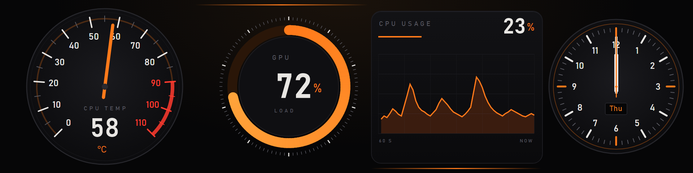
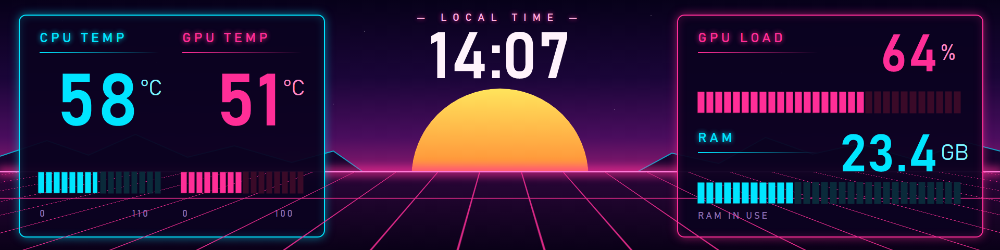

# L-Connect Screen Templates with Claude

Design live sensor dashboards for the **Lian Li Universal Screen 8.8"** (1920×480) just by describing them
to Claude, or bring a mockup from **Claude Design**. This skill turns the design into a native
**L-Connect 3** template: real, live L-Connect widgets placed over your artwork, not a video or a screenshot.


*"Car dashboard style screen: big needle gauge for CPU temp, a ring gauge for GPU load, a scrolling graph of
CPU usage and an analog clock. Dark with orange accents." That prompt produced this, shown here rendered by
L-Connect's own engine with sample values.*



> **Unofficial.** This project is not affiliated with, endorsed by or supported by Lian Li. It drives the
> L-Connect 3 software you already have installed. Lian Li, L-Connect and Universal Screen are trademarks of
> their owners.

## What you can put on the screen

All of these are native L-Connect widgets, updated live by L-Connect:

| Widget | Examples |
|---|---|
| Numbers and text | CPU/GPU temperature, load, clocks, power, fans, RAM/VRAM, network, FPS, model names, time/date/weekday. Any installed font, bold/italic, gradient text |
| Bars | horizontal or vertical, solid, segmented, gradient, outlined, rounded |
| Sliders | a bar with a round knob |
| Arc gauges | rings, 270° gauges, half arcs, pies; segmented, rounded, gradient |
| History charts | scrolling line/area graphs of any sensor |
| Needles | speedometer-style gauges on any sensor; analog clock hands |
| Lian Li sensor rings | L-Connect's own Ring1–Ring5 gauge styles |
| Image layers | artwork that sits above live widgets |

Everything else in your design (panels, dials, tick marks, glows, gradients, labels) is flattened into the
background image, so you can design freely in HTML/CSS/SVG.

## Requirements

- **Windows** with **L-Connect 3** installed and a Universal Screen 8.8" (landscape). The skill uses
  L-Connect's own engine (`lianli.ThemeEngine.dll`) to build and verify templates, so it only runs on the PC
  that drives the screen.
- **Claude Code** (CLI, desktop app or IDE extension) running on that PC. Claude in a browser (claude.ai) can't
  reach L-Connect, so it can't build templates.
- **Python 3** with Pillow and numpy (`pip install pillow numpy`).
- **Google Chrome or Microsoft Edge** (used headless to screenshot the design).

## Install

**As a Claude Code plugin** (recommended):

```
/plugin marketplace add biltrex/lconnect-screen-template
/plugin install lconnect-screen-template@lconnect-screen-template
```

**Or copy the skill** into your personal skills folder:

```powershell
git clone https://github.com/biltrex/lconnect-screen-template
Copy-Item -Recurse lconnect-screen-template\skills\lconnect-screen-template "$env:USERPROFILE\.claude\skills\"
```

## Use it

Start Claude Code in an empty folder and describe what you want:

> make me a minimalist screen for my lian li 8.8 lcd: soft colours, CPU and GPU temps as small ring gauges,
> a RAM bar and a big clock

Claude designs the screen as HTML and builds the template. It previews the result with L-Connect's own
renderer, shows you the design next to the native render, and fixes anything that doesn't match. Then, with
your OK, it installs the template. Iterate the way you would with a designer: "make the clock bigger", "swap
the font", "add a GPU history graph".

You can also:
- **Bring a Claude Design mockup:** "turn this Claude Design file into an L-Connect template". Claude keeps
  your file and adapts a copy.
- **Design in Claude Design yourself:** ask Claude for "the Claude Design brief". It gives you a paragraph to
  paste into Claude Design so the mockup comes out ready to convert.

After installing, restart L-Connect 3 and, in an **Administrator** PowerShell, run
`Restart-Service LConnectService`. Then pick the template in L-Connect's Universal Screen 8.8" template list.

## Things the screen can't do (Claude will tell you when they apply)

- Colours can't change with a value (no "turn red when hot").
- Network rates are always KB/s; VRAM is MB. Weekday names are short and mixed case (`Thu`).
- Animated GIF/video overlays aren't drawn by the 8.8" screen. Animation only plays as a full background
  video, which this skill doesn't build yet.
- FPS only has data while L-Connect's FPS monitoring is running.

## How it works

1. Your design is one 1920×480 HTML page. Live elements are positioned boxes tagged with attributes like
   `data-lc="arc" data-sensor="CPULOAD"` ([design contract](skills/lconnect-screen-template/references/design-contract.md)).
2. Headless Chrome screenshots the page twice: once with everything, and once with only the static art,
   which becomes the template's background layer.
3. Each live element becomes the matching L-Connect widget, built with L-Connect's own classes. Text is
   rendered by L-Connect's engine and nudged until its glyphs land within a pixel of the design.
4. Every build runs the saved template through **L-Connect's actual per-frame device routine** and measures the
   frame against the screen's 1 MB-per-frame limit. That catches the two ways a template can silently show a
   black screen: a layer that throws during drawing, or artwork too detailed to transmit.

The [widget reference](skills/lconnect-screen-template/references/widgets.md) documents every engine widget,
its fields and what was verified on a real screen.

## Troubleshooting

| Symptom | Fix |
|---|---|
| Numbers show in Arial and the layout drifts | The font is installed only for your Windows user. The L-Connect service runs as SYSTEM, so install the font **for all users**, then restart the service. The build warns about this |
| Black screen, and the service log says `send data out of limit` | The frame is over 1 MB. Remove noise/grain textures, fine stripes and big diagonal gradients. The build reports the frame size |
| Template doesn't appear in L-Connect | Restart L-Connect 3 and `LConnectService` (admin), or use L-Connect's own Import |
| Values show `88` | Placeholders until live data arrives |

More in [internals.md](skills/lconnect-screen-template/references/internals.md).

## What it changes on your PC

- It reads L-Connect's installed files and never modifies them.
- With your approval, it copies the finished `.template` into
  `C:\ProgramData\Lian-Li\L-Connect 3\universal-screen-8.8-inch\template\`. It never overwrites an existing
  template unless you ask.
- Anything that needs admin rights (restarting the service, installing fonts for all users) is left for you to run.

## Examples

`examples/` has two designs to try or remix: the car dashboard above, and the synthwave screen. Ask Claude to
"build examples/dash-cluster/dash-cluster.html into a template". The skill also ships two starter designs in
`skills/lconnect-screen-template/assets/`.

## Credits

- The [Lian Li LCD Template Editor](https://github.com/ozgurce/LianliThemeEditor) by ozgurce was a valuable
  reference for how L-Connect templates are structured. This project shares no code with it.
- Built with Claude (Claude Code and Claude Design).

## License

MIT. See [LICENSE](LICENSE).
